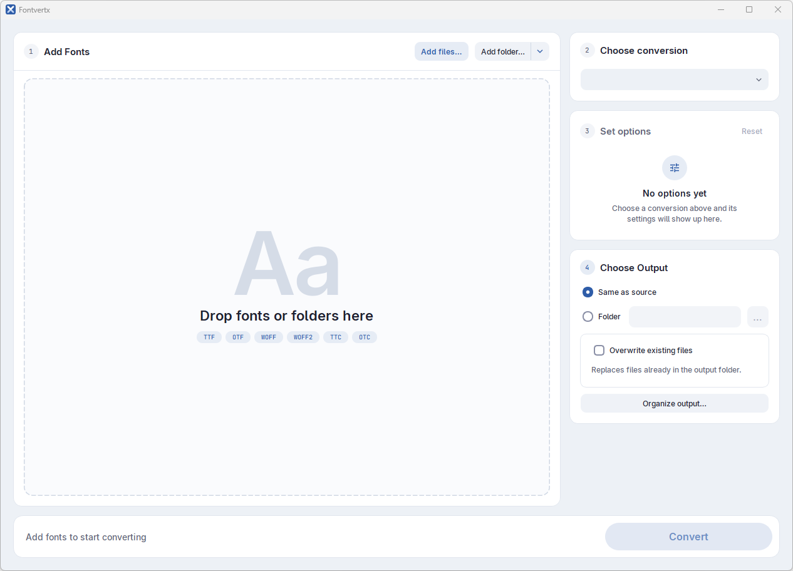

# Fontvertx

<p align="center">
  
</p>

<p align="center">
  A free, open-source font converter for the desktop and the command line.<br>
  Local, batch-ready, and built on established font tools.
</p>

Fontvertx converts fonts between TrueType, PostScript (CFF), WOFF and WOFF2, extracts individual fonts from TTC/OTC collections, and exports variable-font instances as static fonts. It comes as a desktop app (GUI) and a command-line tool (CLI) that share the same conversion engine.



## Features

- **Fully local** — your fonts never leave your machine: no uploads, no online services.
- **Batch processing** — add files or entire folders and convert hundreds of fonts in a single run.
- **Fine-grained control** — curve-conversion tolerance, target UPM, contour simplification, autohinting, subroutinization and more.
- **Organized output** — build a folder structure from font properties and conversion settings.
- **Controllable batches** — pause, resume or cancel mid-run; incompatible fonts are explained, not silently skipped.
- **One engine** — the GUI and the CLI produce identical results.

## Conversions

| Conversion | CLI name |
|---|---|
| TTF → OTF (TrueType → PostScript) | `ttf2otf` |
| OTF → TTF (PostScript → TrueType) | `otf2ttf` |
| TTF / OTF → WOFF / WOFF2 | `ft2wf` |
| WOFF → TTF / OTF | `woff2ft` |
| WOFF2 → TTF / OTF | `woff22ft` |
| Variable → Static | `var2static` |
| Collection (TTC / OTC) → TTF / OTF | `ttc2sfnt` |

## Installation

### Ready-to-run app (no Python needed)

Download the zip for your system from the [latest release](https://github.com/ftCLI/Fontvertx/releases/latest):

- **Windows 10 or 11 (64-bit):** `Fontvertx-<version>-windows-x64.zip` — unzip and run `Fontvertx.exe`.
- **macOS 14.4 or later, Apple Silicon:** `Fontvertx-<version>-macos-arm64.zip` — unzip and move `Fontvertx.app` to Applications.

The apps are not signed, so Windows and macOS warn you on first launch. The [manual](https://github.com/ftCLI/Fontvertx/blob/v1.1.0/docs/manual.md#22-ready-to-run-app-windows-and-macos) explains how to open them.

### With Python (3.12 or later)

```console
uv tool install fontvertx
```

or

```console
python -m pip install fontvertx
```

Then run `fontvertx` for the desktop app or `fontvertx-cli` for the command line.

`uv` downloads a suitable Python by itself if your system has an older one; with `pip` you need Python 3.12 or later already installed.

## Quick start

**Desktop app.** Add fonts with **Add files…**, **Add folder…** or drag and drop, choose a conversion, adjust the options, pick where to save, and press **Convert**.

**Command line:**

```console
# Convert all fonts in a folder and its subfolders to WOFF and WOFF2
fontvertx-cli ft2wf ./fonts --recursive --output-dir ./converted

# TrueType to PostScript with a tighter tolerance
fontvertx-cli ttf2otf ./fonts --tolerance 0.5
```

Run `fontvertx-cli --help` or `fontvertx-cli <conversion> --help` for every option.

> **A note on rights.** Converting a font means modifying it. Make sure the font's license allows it before converting.

## Documentation

The **[user manual](https://github.com/ftCLI/Fontvertx/blob/v1.1.0/docs/manual.md)** covers every conversion and option, variable-font instances, output organization, the CLI, logs and troubleshooting.

## Development

```console
git clone https://github.com/ftCLI/Fontvertx.git
cd Fontvertx
uv sync --group dev
uv run pytest
```

The project uses `ruff`, `mypy`, `bandit` and `pip-audit`; CI runs the tests on Python 3.12, 3.14 and 3.15 on Linux, Windows and macOS, with a 90% coverage threshold.

The ready-to-run apps are built with PyInstaller: `.\packaging\windows\build.ps1` on Windows, `./packaging/macos/build.sh` on a Mac with Apple Silicon. The official builds come from the `build.yml` workflow, which tests each build's CLI and attaches the zips to the GitHub release. To publish a release, follow the [release steps](https://github.com/ftCLI/Fontvertx/blob/main/docs/releasing.md).

## License

MIT — see [LICENSE](https://github.com/ftCLI/Fontvertx/blob/v1.1.0/LICENSE).

## Acknowledgments

Fontvertx is built on excellent open-source tools:

- [FontTools](https://github.com/fonttools/fonttools) — font parsing and writing
- [ttfautohint](https://freedesktop.org/wiki/Software/ttfautohint/) — TrueType autohinting
- [cffsubr](https://github.com/adobe-type-tools/cffsubr) — CFF subroutinization
- [Skia pathops](https://github.com/fonttools/skia-pathops) — contour overlap removal
- [Inter](https://rsms.me/inter/) and [JetBrains Mono](https://www.jetbrains.com/lp/mono/) — interface fonts, under the SIL Open Font License 1.1
- [Material Symbols](https://fonts.google.com/icons) — interface icons, under the Apache License 2.0
