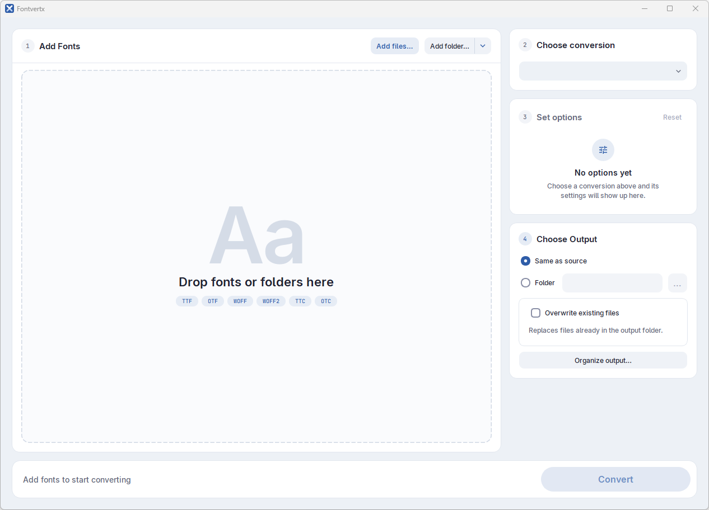
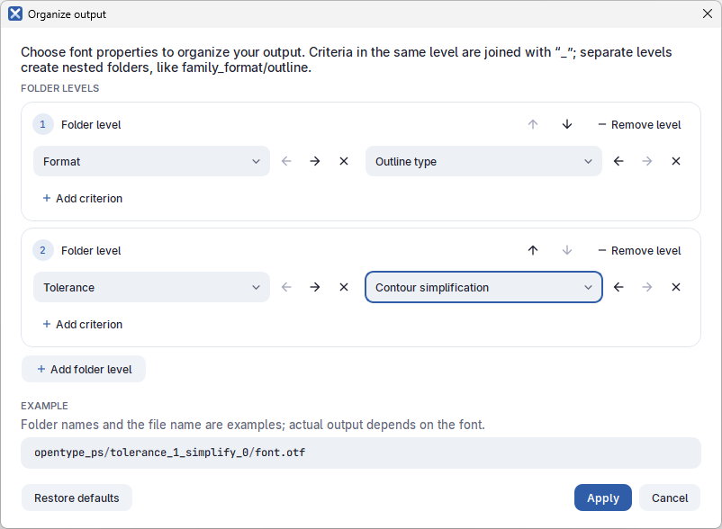
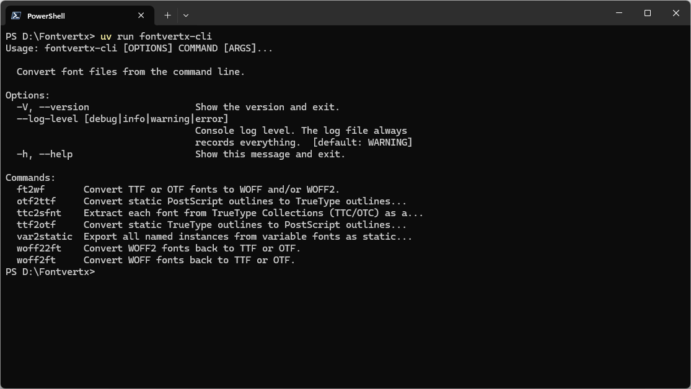

# Fontvertx — User Manual

Version 1.1.0 · November 2026

## Contents

1. [Introduction](#1-introduction)
2. [Installation and launch](#2-installation-and-launch)
3. [The main window](#3-the-main-window)
4. [Step-by-step workflow](#4-step-by-step-workflow)
5. [Conversion profiles and options](#5-conversion-profiles-and-options)
6. [Variable fonts: named and custom instances](#6-variable-fonts-named-and-custom-instances)
7. [Destination and output organization](#7-destination-and-output-organization)
8. [During and after a conversion](#8-during-and-after-a-conversion)
9. [Command-line interface (CLI)](#9-command-line-interface-cli)
10. [Logs and diagnostics](#10-logs-and-diagnostics)
11. [Remembered preferences](#11-remembered-preferences)
12. [Keyboard shortcuts](#12-keyboard-shortcuts)
13. [Troubleshooting](#13-troubleshooting)
14. [Glossary](#14-glossary)

---

## 1. Introduction

Fontvertx is a free, open-source font converter, available as a desktop application (GUI) and as a command-line tool (CLI). It converts fonts between TrueType, PostScript (CFF), WOFF and WOFF2, extracts individual fonts from TTC/OTC collections, and exports variable-font instances as static fonts.

Key features:

- **Fully local** — your fonts never leave your machine: no uploads, no online services.
- **Batch processing** — add files or entire folders and convert hundreds of fonts in a single run.
- **Fine-grained control** — curve-conversion tolerance, target UPM, contour simplification, autohinting, subroutinization and more.
- **Organized output** — build a folder structure from font properties and conversion settings.
- **Controllable batches** — pause, resume or cancel mid-run; incompatible fonts are explained, not silently skipped.
- **One engine** — the GUI and the CLI share the same conversion engine and produce identical results.

Fontvertx is built on established tools: FontTools, ttfautohint, cffsubr and Skia pathops.

> **A note on rights.** Converting a font means modifying it. Before converting, make sure the font's license (EULA) allows it. Fontvertx asks for explicit confirmation before each run (see §4.5).

---

## 2. Installation and launch

### 2.1 Requirements

| Installation | Requirements |
|---|---|
| Ready-to-run app (§2.2) | 64-bit Windows 10 or 11, or macOS 14.4 or later on a Mac with Apple Silicon (M1 or later). No Python needed. |
| From PyPI or from source (§2.3–2.5) | Python **3.12** or later (with uv it is downloaded automatically if needed, §2.3); for the GUI, a desktop environment supported by Qt 6 (Windows, macOS, Linux). |

### 2.2 Ready-to-run app (Windows and macOS)

Download the zip for your system from the [Releases page](https://github.com/ftCLI/Fontvertx/releases/latest):

| File | System |
|---|---|
| `Fontvertx-<version>-windows-x64.zip` | Windows 10 or 11, 64-bit |
| `Fontvertx-<version>-macos-arm64.zip` | macOS 14.4 or later, Apple Silicon |

**Windows.** Unzip the folder anywhere (for example in your user folder) and start `Fontvertx.exe`. The command-line tool, `fontvertx-cli.exe`, is in the same folder. The executables are not signed: on first launch Windows SmartScreen shows *Windows protected your PC*. Click **More info** → **Run anyway**.

**macOS.** Unzip and move `Fontvertx.app` to the Applications folder. The app is not notarized by Apple, so macOS blocks it on first launch. Try to open it once, then go to **System Settings → Privacy & Security** and click **Open Anyway**. If macOS says the app *is damaged*, run in Terminal:

```console
xattr -dr com.apple.quarantine /Applications/Fontvertx.app
```

The command-line tool is inside the app bundle:

```console
/Applications/Fontvertx.app/Contents/MacOS/fontvertx-cli --help
```

To call it as `fontvertx-cli`, add a symbolic link in a folder on your `PATH`:

```console
ln -s /Applications/Fontvertx.app/Contents/MacOS/fontvertx-cli /usr/local/bin/fontvertx-cli
```

Intel Macs are not supported by the ready-to-run app; install from PyPI instead (§2.3–2.4).

### 2.3 With uv (recommended for Python users)

```console
uv tool install fontvertx
fontvertx
```

- To try it without installing: `uvx fontvertx`
- To upgrade: `uv tool upgrade fontvertx`

You do not need to install Python yourself: if your system has no Python 3.12 or later (for example Debian 12 or Ubuntu 22.04), uv downloads one for Fontvertx and keeps it separate from the system Python.

### 2.4 With pip, from PyPI

This method needs Python 3.12 or later already installed. Check the version first: `py --version` on Windows, `python3 --version` on macOS and Linux. If it is older, install a newer Python from [python.org](https://www.python.org/downloads/) or use uv (§2.3).

**Windows (PowerShell):**

```powershell
py -m venv .venv
.\.venv\Scripts\Activate.ps1
python -m pip install fontvertx
fontvertx
```

**macOS and Linux:**

```console
python3 -m venv .venv
source .venv/bin/activate
python -m pip install fontvertx
fontvertx
```

To upgrade: `python -m pip install --upgrade fontvertx`.

### 2.5 From source

```console
git clone https://github.com/ftCLI/Fontvertx.git
cd Fontvertx
uv sync
uv run fontvertx
```

### 2.6 The two commands

| Command | Launches |
|---|---|
| `fontvertx` | the desktop application (GUI) |
| `fontvertx-cli` | the command-line tool (CLI) |

In the ready-to-run apps the same two programs are `Fontvertx.exe` / `fontvertx-cli.exe` on Windows and `Fontvertx.app` / `Fontvertx.app/Contents/MacOS/fontvertx-cli` on macOS.

---

## 3. The main window



The window is made of four numbered cards and a fixed footer.

| Card | Title | Purpose |
|:---:|---|---|
| **1** | **Add Fonts** | Add, filter and select the fonts to convert |
| **2** | **Choose conversion** | Pick the conversion profile |
| **3** | **Set options** | Adjust the options of the selected profile |
| **4** | **Choose Output** | Choose where files are saved and how they are organized |

The **footer** is where conversions run. Before a run it shows the selection summary and the main **Convert** button. During a run it shows the progress and the **Pause** and **Cancel** buttons in place of Convert; afterwards, the outcome with **View log**, **Open output folder** and **Convert** for another run (see §8). It also shows short messages and warnings.

**Adaptive layout.** On wide windows the font list stays beside the conversion and output cards, which scroll independently when needed. On narrow windows the sections stack vertically.

**Card states.** Cards 1 and 2 show a check mark when the step is valid (fonts selected, profile chosen). Card 3 shows a **Modified** chip when the options differ from the factory defaults; the **Reset** button next to its title restores them. Until a profile is chosen, card 3 shows *No options yet*.

---

## 4. Step-by-step workflow

### 4.1 Add fonts (card 1)

There are three ways to add fonts:

- **Add files…** — opens a file picker (default filter: `.ttf` `.otf` `.woff` `.woff2` `.ttc` `.otc`).
- **Add folder…** — adds a folder; only the fonts directly inside it are listed.
- **Drag and drop** files or folders onto the *Drop fonts or folders here* area (or onto the list). The area also lists the supported formats.

To include subfolders, open the arrow next to **Add folder…** and choose **Add folder and subfolders…**. The choice applies folder by folder.

The scanner inspects file contents, not extensions, so it finds fonts regardless of their names or extensions. While scanning, a bar shows progress (*Scanning fonts… n / total*); **Stop** ends the scan and keeps the fonts found so far.

**Clear list** empties the list.

### 4.2 Choose a profile (card 2)

Open the *Choose a conversion…* menu and pick a profile. Profiles are grouped by category:

| Group | Menu entry | CLI name |
|---|---|---|
| Outlines | TTF → OTF (TrueType → PostScript) | `ttf2otf` |
| Outlines | OTF → TTF (PostScript → TrueType) | `otf2ttf` |
| Web fonts | TTF / OTF → WOFF / WOFF2 | `ft2wf` |
| Web fonts | WOFF → TTF / OTF | `woff2ft` |
| Web fonts | WOFF2 → TTF / OTF | `woff22ft` |
| Other | TTFV / OTFV → TTF / OTF (Variable → Static) | `var2static` |
| Other | TTC / OTC → TTF / OTF (Collection → Singles) | `ttc2sfnt` |

You can pick a profile before adding fonts. No profile is preselected when the app starts: you choose one every time. Within the same session, the profile stays selected after a conversion.

### 4.3 Select fonts

The font table shows each file's name, format, outline type (TrueType or PostScript) and UPM.

- **Optional columns** — right-click the table header to show the **Family** and **Style** columns. The choice is remembered. Filtering searches these fields even when the columns are hidden.
- **Sorting** — click a column header.
- **Filter** — the *Filter fonts…* field filters by name, family, style, format, outlines or UPM.
- **Selection** — check the fonts to convert. The checkbox at the top selects or clears all visible compatible fonts.
- **Hide incompatible** — hides fonts that cannot be used with the selected profile.
- **Full path** — hover over a font's name to see the file's full path.

**Incompatible fonts.** When a font does not suit the profile, it is greyed out and the reason is shown: beside the name (when space permits), in the name's tooltip, and below the table when the font is selected. Example reasons:

| Reason | Meaning |
|---|---|
| Not a TrueType font / Not a PostScript font | The outlines are not the type the profile requires |
| Variable fonts are not supported | Use the Variable → Static profile |
| Font collections require the Collection (TTC/OTC) → TTF / OTF profile | Collections must be extracted first |
| Already a web font / Not a web font | The source format does not match the profile |
| Not a variable font / Not a font collection | The profile requires a variable font or a collection |

### 4.4 Set options and destination (cards 3 and 4)

- The **Set options** card shows only the options of the selected profile (see §5), followed by the options shared by all profiles.
- In the **Choose Output** card, pick the destination folder and, optionally, a subfolder organization (see §7).

Options are stored per profile: each profile remembers its own values across sessions.

### 4.5 Convert

1. Check the summary in the footer: profile, number of selected fonts, destination.
2. Press **Convert** (the label shows how many fonts will be converted) or **Ctrl+Enter**.
3. Fontvertx asks you to confirm that you have the legal right to modify the selected fonts (*Confirm font modification rights*). **I have permission** continues; checking **Remember this choice** skips the confirmation on future runs. Without it, you will be asked again next time.
4. The conversion runs in the footer, which shows the progress, the file being converted and the **Pause** and **Cancel** buttons (see §8). The cards stay visible but cannot be changed until the run ends.

---

## 5. Conversion profiles and options

Hover over an option's label to see a short explanation.

### 5.1 TTF → OTF (`ttf2otf`)

Converts static TrueType outlines (quadratic curves) to PostScript/CFF outlines (cubic curves).

| Option | Values | Default | Description |
|---|---|---|---|
| Tolerance | 0.1 – 3.0 | 1 | Curve-conversion accuracy in thousandths of an em; the actual deviation scales with UPM. Lower values preserve more detail but may increase point count and file size. |
| Set target UPM | 16 – 16384 | off | Scales the font to the given units-per-em value. |
| Contour simplification | 0 – 3 | 0 (off) | Experimental. Merges neighboring smooth curves to reduce point count. Deviation is a multiple of Tolerance. |
| Subroutinize | on / off | on | Compresses CFF outlines using shared subroutines (cffsubr). |

### 5.2 OTF → TTF (`otf2ttf`)

Converts static PostScript outlines to TrueType outlines.

| Option | Values | Default | Description |
|---|---|---|---|
| Tolerance | 0.0 – 3.0 | 1 | As above; 0 is allowed here. |
| Set target UPM | 16 – 16384 | off | Scales the font to the given value. |
| Autohint | on / off | on | Adds TrueType hinting instructions with ttfautohint. |

### 5.3 TTF / OTF → WOFF / WOFF2 (`ft2wf`)

Creates web fonts from desktop fonts.

| Option | Default | Description |
|---|---|---|
| Output format: WOFF / WOFF2 | both on | Formats to create; at least one must be on. |
| Obfuscate names | off | Replaces the family, full and PostScript names with hashes, also in the file name. |
| Remove unused glyphs | off | Drops glyphs not reachable from the cmap or the OpenType features. |
| Remove non-Windows names | off | Removes name records whose platform ID is not 3 (e.g. Macintosh records). |
| Remove DSIG table | off | WOFF only: removes the digital signature table (WOFF2 does not support it). |
| Create CSS | off | Writes a `fonts.css` file with `@font-face` rules and a class for each detected OpenType feature (e.g. `.ft-liga`). |

### 5.4 WOFF → TTF / OTF (`woff2ft`) and WOFF2 → TTF / OTF (`woff22ft`)

Convert web fonts back to their original desktop format (TTF or OTF, depending on the outlines). No profile-specific options.

### 5.5 TTC / OTC → TTF / OTF (`ttc2sfnt`)

Extracts each font in a collection as a separate file. Each file is named after the extracted font's PostScript name. No profile-specific options.

### 5.6 Variable → Static (`var2static`)

Exports variable-font instances as static fonts. See §6 for instance management.

| Option | Default | Description |
|---|---|---|
| Set target UPM | off | Scales the exported fonts. |
| Autohint (TrueType only) | on | Applied to instances with TrueType outlines. |
| Subroutinize (PostScript only) | on | Applied to instances with PostScript outlines. |

Only the options that apply to the outlines of the selected variable fonts are shown.

### 5.7 Options shared by all profiles

| Option | Default | Description |
|---|---|---|
| Recalculate bounding boxes | on | Rebuilds glyph bounds before saving. |
| Recalculate modified timestamp | off | Sets a fresh modification timestamp in the font. |
| Reorder tables on save | on | Uses a standard table order for compatibility. |

These options are also stored per profile and restored by **Reset**.

---

## 6. Variable fonts: named and custom instances

With **Variable → Static** selected, the font list becomes a tree: each variable font is a parent and its instances are checkable children. When there is a single variable font, its instances are shown right away.

- **Named instances** — those predefined in the font (`fvar` table). Check the ones to export.
- **Custom instances** — defined by you, with any value on each axis.

### 6.1 Add a custom instance

1. Select a font or one of its instances.
2. Press **Add custom instance…** (or the **Ins** key).
3. In the *Axis values for …* dialog, enter one value per axis; the allowed range is shown beside each axis. A preview shows the resulting file name.
4. Confirm. If an instance with the same coordinates already exists, Fontvertx tells you and selects the existing one.

### 6.2 Edit or remove a custom instance

- Double-click a custom instance to edit it.
- Right-click (or **Shift+F10**) for the context menu: **Edit custom instance…**, **Remove instance**.
- **Delete** removes the selected custom instance.

Use **Expand all** / **Collapse all** to expand or collapse every variable font, and the *Filter fonts or instances…* field to search by name, coordinates or path.

### 6.3 Exported file names

- **Named instances:** `FileName-InstanceName` (spaces removed), e.g. `Inter-SemiBold.ttf`.
- **Custom instances:** `FileName-` followed by the coordinates, e.g. `Inter-opsz11-wght450.ttf`.

Any bracketed part of the source file name (e.g. `[wght]`) is removed.

---

## 7. Destination and output organization

### 7.1 Destination folder

- **Same as source** (default) — each converted file is saved next to its source.
- **Folder** — all files are saved in the folder chosen with the **…** button.

### 7.2 Existing files

By default, existing files are not overwritten: a conflicting name gets a numbered suffix, such as `font#1.otf`. Enable **Overwrite existing files** (highlighted amber panel) only when you really want to replace files already in the output folder.

### 7.3 Organize output…

The **Organize output…** button opens a dialog for building a folder structure from font properties and conversion settings.



1. Press **Add folder level** for each level of folders you want.
2. In each level, add one or more criteria with **Add criterion**.
3. Criteria in the same level are joined with `_`; separate levels create nested folders.
4. Use the arrows to reorder levels and criteria; the example path updates as you go.
5. Confirm with **Apply**. **Restore defaults** removes every level.

Available criteria (depending on the profile):

| Criterion | Folder value | Profiles |
|---|---|---|
| Family | family name | all |
| Format | `opentype`, `woff`, `woff2` | all |
| Outline type | `tt` or `ps` | all |
| UPM | e.g. `upm_1000` | TTF → OTF, OTF → TTF, Variable → Static |
| Tolerance | e.g. `tolerance_1` | TTF → OTF, OTF → TTF |
| Contour simplification | e.g. `simplify_0` | TTF → OTF |

Each criterion can be used once; if they are all in use, remove one before adding it elsewhere.

**Example.** With **Format** and **Outline type** in the first level and **UPM** in the second:

```text
opentype_ps/upm_1000/font.otf
```

When folder levels are configured, the example also appears below the controls of card 4. It is illustrative: actual names depend on the fonts and settings. Without folder levels, files are saved directly in the chosen destination. The organization is stored per profile.

---

## 8. During and after a conversion

### 8.1 Progress in the footer

While a run is in progress, the footer shows **Converting…**, the count of processed fonts (for example `37 / 146`), the path of the font being converted and a progress bar. **Pause** and **Cancel** take the place of Convert, and the keyboard focus moves to **Pause**. **Ctrl+Enter** does nothing until the run ends.

| Button | Effect |
|---|---|
| **Pause** / **Resume** | Pauses after the font being converted: until it is done, the footer shows **Pausing…** and *Pauses when the current font is done.* (hover over that line to see the font's path). Resume continues with the next one. While paused, the footer shows **Paused** and Resume is the highlighted button. |
| **Cancel** | Stops the conversion after the font being converted: until then, the footer shows **Cancelling…** and *Stops when the current font is done.* A paused run stops at once. Files already converted are kept. |
| **View log** (eye icon) | Opens the log window (§8.3), which updates live during the run. |

During the run the cards are dimmed and cannot be changed, and fonts cannot be dropped onto the window; you can still scroll the font list to look through it. Everything becomes available again when the run ends.

With a large font this wait can take several seconds; the count, progress bar and time keep updating meanwhile, and the log records the request. The reported total time excludes pauses.

### 8.2 Outcome

When the run ends, the footer shows a colored chip with the outcome, the counts and the total time:

- **Done** (green) — *n* converted · *time*
- ***m* failed** (red) — *n* converted · *time*: some fonts could not be converted
- ***k* skipped** (amber) — *n* converted · *time*
- **Cancelled** — *n* of *total* converted · *time*
- **Error** (red) — conversion stopped · *n* converted · *time*

On the right: **View log** (highlighted in red when some fonts failed), **Open output folder** and **Convert**, ready for another run. In a narrow window, View log and Open output folder are shown as round icon buttons; hover over them for their names.

### 8.3 The log window

**View log** opens the log of the last run in a separate window. It does not block the main window: you can keep it open while you use the app, and it updates live during a run. Pressing View log again brings the open window to the front.

The window shows the title *Last run · profile* (for example *Last run · TTF → OTF*), the outcome chip, a summary line (counts, duration and finish time) and the full log. **Save logs…** exports the log as JSON Lines (`.jsonl`); **Close** closes the window. Closing it never stops or changes a conversion.

When the footer shows the selection summary again (for example after you change profile), the **View log** link next to it reopens the log of the last run.

### 8.4 Closing the app during a conversion

- **Paused conversion:** you can resume (**Resume**), cancel (**Cancel conversion**) or keep the window open (**Keep window open**).
- **Running conversion:** Fontvertx asks whether to wait for it to finish; if you answer **Yes**, the window closes automatically when the run ends.
- **Force close:** a last resort when a conversion is stuck (e.g. on a corrupt font). **Warning:** the font being converted may be left corrupted on disk.

---

## 9. Command-line interface (CLI)



### 9.1 Syntax

```console
fontvertx-cli [--log-level LEVEL] PROFILE [OPTIONS] INPUTS...
```

- `INPUTS...` — one or more files or folders. Folders are not scanned recursively unless `--recursive` is used.
- `-h`, `--help` — shows general or per-profile help (`fontvertx-cli ttf2otf --help`).
- `--log-level` — console message level: `DEBUG`, `INFO`, `WARNING` (default), `ERROR`. The log file always records everything.
- `--version` — prints the version.

### 9.2 General options (all profiles)

| Option | Default | Description |
|---|---|---|
| `--output-dir FOLDER` | each input's folder | Folder for converted files. |
| `--recursive` / `--no-recursive` | off | Scans input folders recursively. |
| `--overwrite` / `--no-overwrite` | off | Replaces existing files (otherwise numbered copies). |
| `--recalc-bboxes` / `--no-recalc-bboxes` | on | Recalculates glyph bounding boxes. |
| `--recalc-timestamp` / `--no-recalc-timestamp` | off | Sets a fresh modified timestamp. |
| `--reorder-tables` / `--no-reorder-tables` | on | Reorders tables when saving. |

### 9.3 Per-profile options

**`ttf2otf`**

| Option | Values | Default |
|---|---|---|
| `--tolerance` | 0.1 – 3 | 1.0 |
| `--simplify` | 0 – 3 | 0 |
| `--target-upm` | 16 – 16384 | none |
| `--subroutinize` / `--no-subroutinize` | — | on |

**`otf2ttf`**

| Option | Values | Default |
|---|---|---|
| `--tolerance` | 0 – 3 | 1.0 |
| `--target-upm` | 16 – 16384 | none |
| `--autohint` / `--no-autohint` | — | on |

**`ft2wf`**

| Option | Default |
|---|---|
| `--woff` / `--no-woff` | on |
| `--woff2` / `--no-woff2` | on |
| `--obfuscate-names` / `--no-obfuscate-names` | off |
| `--remove-unused-glyphs` / `--no-remove-unused-glyphs` | off |
| `--remove-non-windows-names` / `--no-remove-non-windows-names` | off |
| `--remove-dsig` / `--no-remove-dsig` | off |
| `--css-kit` / `--no-css-kit` | off |

**`woff2ft`, `woff22ft`, `ttc2sfnt`** — general options only.

**`var2static`**

| Option | Default |
|---|---|
| `--target-upm` | none |
| `--autohint` / `--no-autohint` | on |
| `--subroutinize` / `--no-subroutinize` | on |

From the command line, `var2static` exports all named instances of each variable font. If a font has no named instances, its default instance is exported (with a warning). Custom instances are available in the GUI only.

### 9.4 Examples

```console
# Convert all fonts in a folder and its subfolders to WOFF/WOFF2
fontvertx-cli ft2wf ./fonts --recursive --output-dir ./converted

# WOFF2 only, with a CSS file
fontvertx-cli ft2wf ./fonts --no-woff --css-kit

# TTF → OTF with a tighter tolerance and no subroutinization
fontvertx-cli ttf2otf ./fonts --tolerance 0.5 --no-subroutinize

# OTF → TTF scaled to 2048 UPM, without autohinting
fontvertx-cli otf2ttf MyFont.otf --target-upm 2048 --no-autohint

# Extract the fonts from a collection
fontvertx-cli ttc2sfnt Family.ttc --output-dir ./singles

# Export named instances with verbose logging
fontvertx-cli --log-level DEBUG var2static ./variable
```

### 9.5 Output and exit codes

While running, the CLI shows progress (`Progress: n/total`) and, for each font, a `Converted:`, `Skipped:` or `Failed:` line. At the end it prints a summary:

```text
Summary: 12 converted, 3 skipped, 0 failed.
```

The exit code is `0` on success and `1` on errors or when no compatible fonts were found.

---

## 10. Logs and diagnostics

Both the GUI and the CLI write a full diagnostic log (down to DEBUG) to a rotating file, `fontvertx.log` (1 MB, 3 backups):

| System | Log folder |
|---|---|
| Windows | `%LOCALAPPDATA%\Fontvertx\logs` |
| macOS | `~/Library/Logs/Fontvertx` |
| Linux | `~/.local/state/fontvertx/logs` (or `$XDG_STATE_HOME/fontvertx/logs`) |

Set the `FONTVERTX_LOG_DIR` environment variable to use a different folder. The ready-to-run apps use the same folders.

In the GUI, the log of a single run can also be exported as JSON Lines with **Save logs…** in the log window (§8.3).

---

## 11. Remembered preferences

Fontvertx remembers across sessions:

- each profile's options (card 3);
- each profile's output organization levels;
- the last input, output and log-saving folders;
- the state of **Hide incompatible** and of the optional **Family** / **Style** columns;
- the rights confirmation, if you chose **Remember this choice**;
- window size and position.

The conversion profile is not remembered: you choose it again at every launch.

To restore a profile's options to the factory defaults, use **Reset** in card 3; to remove the output organization, use **Restore defaults** in the *Organize output* dialog.

---

## 12. Keyboard shortcuts

| Keys | Action |
|---|---|
| **Ctrl+Enter** | Start the conversion (does nothing while a run is in progress) |
| **Ins** | Add a custom instance (instance tree) |
| **Delete** | Remove the selected custom instance |
| **Shift+F10** | Context menu of the selected instance |
| **Double-click** | Edit a custom instance |
| **Enter** / **Space** | Activate the focused button |

On macOS, Ctrl maps to Cmd following Qt conventions.

---

## 13. Troubleshooting

| Problem | Solution |
|---|---|
| Windows shows *Windows protected your PC* | The ready-to-run app is not signed. Click **More info** → **Run anyway** (§2.2). |
| macOS won't open the app, or says it *is damaged* | The app is not notarized. Use **Open Anyway** in Privacy & Security, or remove the quarantine flag with `xattr` (§2.2). |
| pip reports *No matching distribution found for fontvertx*, or *requires a different Python* | Your Python is older than 3.12. Install with uv, which brings its own Python (§2.3), or install Python 3.12 or later (§2.4). |
| The **Convert** button is disabled | Choose a profile (*Choose a conversion profile first.*) and select at least one compatible font. |
| *No compatible fonts for this conversion* | No font in the list suits the profile: check the incompatibility reasons (§4.3) or change profile. |
| *Choose at least one web font format to continue.* | In the WOFF / WOFF2 profile, enable at least one of the two formats. |
| An added folder does not show all its fonts | **Add folder…** does not include subfolders: use **Add folder and subfolders…** (or `--recursive` in the CLI). |
| Converted files have a `#1`, `#2` … suffix | A file with the same name already existed. Enable **Overwrite existing files** to replace it. |
| *One or more selected inputs no longer exist.* | Some files were moved or deleted after being added: remove them or reload the list. |
| The conversion seems stuck on a font | Try **Pause** or **Cancel**; as a last resort close the window and choose **Force close** (§8.4). Check the log file (§10). |
| TTF → OTF output has too many points | Increase **Tolerance** or try **Contour simplification** (experimental). |

To report a problem, open an issue on [GitHub](https://github.com/ftCLI/Fontvertx/issues) and attach the `fontvertx.log` file or the run's JSON Lines export.

---

## 14. Glossary

- **TrueType (TT)** — outline format based on quadratic Bézier curves; typically `.ttf` files.
- **PostScript / CFF (PS)** — outline format based on cubic Bézier curves; typically `.otf` files.
- **SFNT** — the container shared by TTF and OTF.
- **WOFF / WOFF2** — compressed formats for the web.
- **TTC / OTC** — collections holding several fonts in a single file.
- **Variable font** — a font with one or more axes of variation (weight, width, optical size…).
- **Instance** — a specific point in a variable font's design space, exportable as a static font.
- **UPM (units per em)** — the size of the font's design grid (e.g. 1000 or 2048).
- **Hinting** — instructions that improve glyph rendering at low resolutions.
- **Subroutinization** — compression of CFF outlines through shared subroutines.

---

*Fontvertx is released under the MIT License. Built with FontTools, ttfautohint, cffsubr and Skia pathops.*
